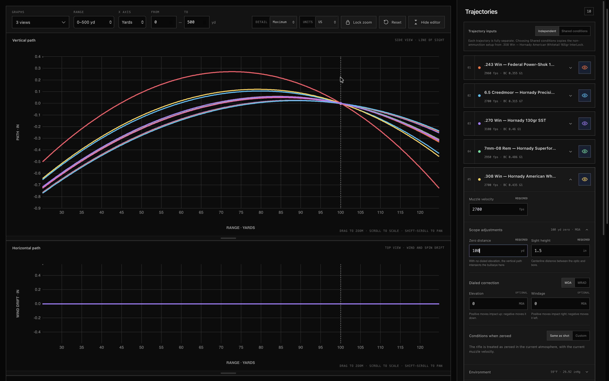

# Ballistics Visualizer

An interactive, client-side web application for visualizing and comparing external ballistic trajectories.

Ballistics Visualizer makes it easy to explore how projectile characteristics, atmospheric conditions, wind, sight configuration, and shooting angle affect a trajectory. Multiple configurations can be compared simultaneously across interactive graphs for trajectory, drift, velocity, energy, and point of impact.

The project was loosely inspired by the [Winchester Ballistics Calculator](https://ballisticscalculator.winchester.com/#!/).

[Ballistics Visualizer](https://ballisticsvisualizer.com)


## Features

* Compare multiple independently configured trajectories side by side.
* Visualize vertical trajectory, horizontal drift, velocity, kinetic energy, and point of impact.
* Inspect trajectory values interactively at any distance.
* Use known G1 or G7 ballistic coefficients, or estimate a coefficient from measured range and drop data.
* Configure zero distance, sight height, MOA/MRAD corrections, atmospheric conditions, wind, shooting angle, and spin drift.
* Switch between US customary and metric units without changing the underlying simulation.
* Use yards or feet for the imperial range axis.
* Pan, zoom, resize, reorder, and selectively display graphs.
* Lock graph zoom while scrolling the page.
* Save configurations locally in the browser.
* Import and export complete trajectory sets as JSON.
* Export selected active trajectory results as CSV, JSON, or a PDF report.

## How It Works

Trajectory calculations run entirely in the browser using the WebAssembly-powered [ballistics-engine](https://github.com/ajokela/ballistics-engine). No backend or external calculation service is required.

For each visible trajectory, the application passes projectile properties, muzzle velocity, sight geometry, atmospheric conditions, wind, shooting angle, and optional spin parameters to the solver.

Solver results are normalized into a shared trajectory model and cached beyond the currently displayed graph range. Values between calculated points are interpolated for interactive graph inspection and the point-of-impact view.

Interactive charts are rendered with [uPlot](https://github.com/leeoniya/uPlot), while Zod validates editable configuration data before it reaches the solver.

### Units

The internal ballistic model uses:

* yards
* inches
* feet per second
* grains
* miles per hour
* Fahrenheit
* inHg

Metric conversion occurs at the interface boundary. Changing display units therefore affects only presentation—the underlying physical solution and stored configuration remain unchanged.

## Configuration Files

The current trajectory set is automatically persisted in browser storage.

Configurations can also be exported as JSON. Exported files contain a format version and the complete configuration for each trajectory. Imported files are validated before being loaded and are added to the existing trajectory set rather than replacing it.

Fresh installations load the bundled example configuration. It uses the same format produced by the **Export JSON** feature, so an exported configuration can be used directly as a replacement default.

Existing browser storage takes precedence over the bundled configuration.

### Generate a configuration with AI

Give an AI the standalone [JSON Schema](public/shot-file.schema.json) and describe
the trajectories you want. The schema includes every supported trajectory field,
units, allowed values, numeric limits, conditional requirements, defaults, and a
complete example. It has no external schema dependencies. Vite also serves it at
`/shot-file.schema.json` when running or hosting the app.

For example, attach the schema and use this prompt, replacing the bracketed text:

```text
Generate a Ballistics Visualizer JSON configuration that conforms to the attached
schema for [describe the trajectories and conditions you want].
Use the schema descriptions and example to understand the options. Use unique
trajectory IDs and the units specified in the field names. Use my supplied data;
ask for missing essential projectile data rather than inventing specifications.
Use defaults for unspecified conditions and omit unused optional numeric fields.
Return only the JSON file content, without Markdown fences or commentary.
```

Save the response as a `.json` file and load it with **Import JSON**. The schema
requires the main calculation inputs so generated files are ready to use; the
importer also accepts unfinished configurations saved from the editor. A schema
checks structure and limits, not the accuracy of projectile specifications.

## Results Export

Choose **Export results** in the graph controls to select active trajectories and a sampling interval (10 of the selected range units by default). Results cover the configured graph range, including its endpoints and each interval multiple between them. Zooming does not change the export range. Exports follow the UI's unit system and range axis: meters, centimeters, m/s, and joules in metric; yards or feet, inches, fps, and ft-lb in US units. Vertical offset is signed relative to the line of sight. Energy is unavailable when bullet weight is omitted.

CSV includes a row per trajectory and distance, with selectable columns. Range, vertical offset, velocity, and energy are included by default; trajectory ID and name are optional. Results JSON includes sampled data and trajectory settings with explicit units. PDF reports give each selected trajectory readable settings first, then a results table, each starting on its own portrait page. A landscape graph fills the final page of each trajectory's section, with only axis labels and a small trajectory name inside the plot. Long tables continue onto additional pages. Exports are limited to 10,000 total table rows; use a larger interval or select fewer trajectories for large ranges.

The existing **Export JSON** and **Import JSON** actions in the trajectory editor continue to save and restore configurations separately. Results JSON uses its own format and is intended for analysis.

## Development

Requires Node.js 20.19 or newer and npm.

```bash
git clone <repository-url>
cd ballistics-visualizer

npm install
npm run dev
```

Open the local URL printed by Vite.

### Commands

```bash
npm run dev      # Start the development server
npm run build    # Type-check and create a production build
npm run preview  # Preview the production build
npm test         # Run the test suite
npm run lint     # Run ESLint
```

## Technology

* TypeScript
* WebAssembly
* [ballistics-engine](https://github.com/ajokela/ballistics-engine)
* [uPlot](https://github.com/leeoniya/uPlot)
* Zod
* Vite

## License

Ballistics Visualizer is licensed under the MIT License.
